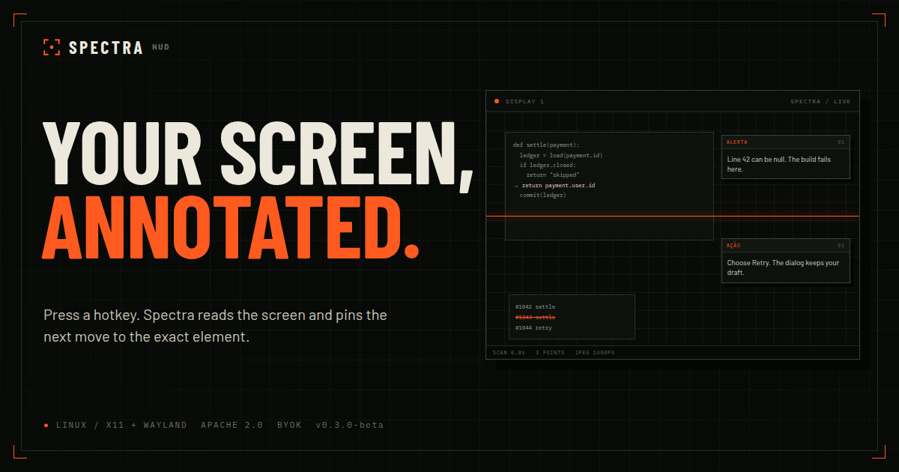

# Spectra HUD

> A screen-aware HUD for Linux. Press a hotkey, and Spectra looks at your screen and pins 1–3 actionable cards to the exact elements that matter.

[](LICENSE)
[](https://www.python.org/)
[](#requirements)

**Status: v0.2.1 — experimental.** Linux + X11 only. Bring your own API key. Interface in PT-BR, English or Spanish; model responses follow the UI language.

[**Website**](https://kaiqueramos.github.io/spectra-hud/) · [**GitHub**](https://github.com/kaiqueramos/spectra-hud) · [**Privacy**](PRIVACY.md) · [**LGPD**](docs/LGPD.md)

<p align="center">
  <a href="https://kaiqueramos.github.io/spectra-hud/">
    
  </a>
</p>

---

## Why

Most AI assistants wait for you to type. Spectra reads the screen and answers **in place**: a tactical overlay for games, IDEs, dashboards and anything where context is visual.

Press `Ctrl+Alt+Space` → Spectra captures the active monitor, asks a vision model what matters, and draws small cards anchored to the relevant UI elements. Click a card to ask a follow-up; drag it anywhere.

## How it works

1. A global hotkey captures the monitor under the mouse cursor (`mss`).
2. The frame is downscaled to 1600 px and sent as JPEG to an OpenAI-compatible vision endpoint.
3. The model returns up to three insights with an optional `box_2d` (normalized 0–1000).
4. Cards and a thin target bar are drawn with Tkinter/X11 next to each element.
5. A 1-hour sliding session memory feeds context into the next scan.

No server, no telemetry. The screenshot goes only to the endpoint **you** configure.

## Features

- **Command center** (`Ctrl+Alt+C`): provider presets, base URL, model, API key, consent, pause, blocklist, hotkeys and pricing.
- **First-run wizard**: opens automatically when there is no key or consent.
- **Vision test**: sends a red/blue image and confirms the model actually sees it.
- **10 themes** (5 dark, 5 light) with live preview; `Ctrl+T` cycles. See [docs/THEMES.md](docs/THEMES.md).
- **3 interface languages** (PT-BR, EN, ES); the model answers in the selected language. See [docs/I18N.md](docs/I18N.md).
- **Frameless Spectra titlebar** with drag, hide and close; custom switches, pill buttons and live theme cards.
- **Telemetry and system panels**: latency, tokens, cost, provider, keyring, consent, privacy and cache.
- **YAML config** (`~/.config/spectra-hud/config.yaml`) for every setting; reload with `Ctrl+R`. See [docs/CONFIG.md](docs/CONFIG.md).
- **Microanimations** (scanline, pulsing LED, switches) with an on/off toggle.
- **System keyring** for the API key (fallback to a 600 config file).
- **Tray icon** (AppIndicator) with scan, pause and quit.
- Global scan hotkey with toggle and a “scanning” indicator.
- **Cancel** an in-flight scan from the indicator or the same hotkey.
- Up to 3 anchored cards, draggable, click-to-ask.
- Global command bar (`Ctrl+Shift+Space`) for free-form questions about the screen.
- **Private mode** (`Ctrl+Alt+P`) and a **window-title blocklist** for banking/password windows.
- Session memory with sliding TTL (1 h), stored under XDG state.
- Multi-monitor aware (X11), with a safe side-column fallback when the model’s box is bad.
- Bring your own key: any OpenAI-compatible vision model.
- Local models via Ollama.
- 61 unit tests.

## Requirements

- Linux with **X11** (Wayland is not supported in v0.2; the app fails with a clear message).
- Python **3.10+** with Tkinter (`sudo apt install python3-tk`).
- `xdotool` is optional (Xlib fallback is built in).
- `keyring` and `pystray` are installed by `requirements.txt`; the tray needs the GNOME AppIndicator extension.
- An API key for an OpenAI-compatible vision endpoint (or a local Ollama model).
- Optional: **Share Tech Mono**, **FiraCode Nerd Font** and **Ubuntu** for the intended typography; the app falls back to DejaVu.

## Quick start

```bash
git clone https://github.com/kaiqueramos/spectra-hud.git
cd spectra-hud
./install.sh
./run.sh
```

The first run opens the **command center**. Choose a provider, paste the key, click **Test vision**, accept the consent and save. The key goes to the system keyring; settings go to `~/.config/spectra-hud/config.yaml` (with a `config.json` fallback).

Manual install:

```bash
python3 -m venv .venv
. .venv/bin/activate
pip install -r requirements.txt
python3 main.py
```

`.env` is still supported as an override/migration path, but it is no longer required.

## Command center

| Field | Meaning |
|---|---|
| Provider | OpenCode Go, OpenCode Zen (free), CommandCode, Ollama or Custom |
| Base URL | OpenAI-compatible endpoint |
| Model | Provider-specific vision model ID |
| API key | Stored in the system keyring; never committed |
| Consent | Explicit LGPD consent for sending screenshots |
| Pause | Private mode: nothing is captured |
| Blocklist | Window-title terms that block a scan |
| Hotkeys | Scan, command bar, center, pause (restart to apply) |
| Pricing | Optional `$ / 1M` input/output for cost display |
| Language | PT-BR, English or Spanish (UI and model response) |
| Animations | Scanline, LED pulse and switch transitions |
| YAML | Open/reload `config.yaml`; all keys are documented in [docs/CONFIG.md](docs/CONFIG.md) |

The telemetry panel shows the last scan latency, tokens and cost; the status line shows the last action and model. Cost appears when pricing is set.

## Configuration

Settings live in `~/.config/spectra-hud/config.yaml` (mode 600, editable). `config.json` is written alongside as a legacy fallback, and **YAML wins** when both exist. The key lives in the system keyring. Environment variables override the files:

```yaml
# ~/.config/spectra-hud/config.yaml
provider: commandcode
base_url: https://api.commandcode.ai/provider/v1
model: deepseek/deepseek-v4.1-flash
language: pt
theme: spectra
animations: true
paused: false
consent: true
blocklist: [1password, bitwarden, banco]
hotkeys:
  scan: "<ctrl>+<alt>+<space>"
  bar: "<ctrl>+<shift>+<space>"
  center: "<ctrl>+<alt>+c"
  pause: "<ctrl>+<alt>+p"
pricing:
  deepseek/deepseek-v4.1-flash: {in: 0.0, out: 0.0}
```

Use **YAML** to open the file and **RECARREGAR** / `Ctrl+R` to apply edits. New hotkeys require an app restart. See [docs/CONFIG.md](docs/CONFIG.md) for every key and the precedence rules.

| Variable | Meaning |
|---|---|
| `SPECTRA_API_KEY` | Provider key |
| `SPECTRA_BASE_URL` | OpenAI-compatible base URL |
| `SPECTRA_MODEL` | Vision model |
| `SPECTRA_HOTKEY` | Scan hotkey override (pynput syntax) |
| `SPECTRA_HOTKEY_BAR` | Command bar hotkey override |

Legacy names (`OPENCODE_GO_API_KEY`, `OPENCODE_GO_BASE_URL`, `MODEL_NAME`) and `.env` are read once for migration.

See [docs/PROVIDERS.md](docs/PROVIDERS.md) for presets and the vision test.

## Hotkeys

| Key | Action |
|---|---|
| `Ctrl+Alt+Space` | Scan screen / close HUD / cancel an in-flight scan |
| `Ctrl+Shift+Space` | Global command bar |
| `Ctrl+Alt+C` | Command center |
| `Ctrl+Alt+P` | Pause / resume |
| `Ctrl+T` | Cycle themes in the command center |
| `Alt+1..3` | Open the question box for card 1..3 |
| `Esc` | Close the active prompt |
| Click card | Ask a follow-up about that item |
| Drag card | Reposition it |

**Hotkey note:** the default is `Ctrl+Alt+Space` because `Ctrl+Space` is the autocomplete shortcut in VS Code and JetBrains IDEs.

## Privacy and cost

Every scan sends a JPEG of the **active monitor** to the endpoint you configure. That may include passwords, private messages or financial data on screen. Read [PRIVACY.md](PRIVACY.md) and [docs/LGPD.md](docs/LGPD.md) before using it on sensitive screens.

- No analytics, no telemetry, no Spectra server.
- Explicit consent is required before the first scan.
- The window-title blocklist and private mode are local controls, not a guarantee.
- The session cache lives in `~/.local/state/spectra-hud/session.json` (text only, 1 h).
- Logs live in `~/.local/state/spectra-hud/spectra.log` (no screenshots, no keys).
- Each scan is one vision request billed by your provider.

## Known limitations

- **X11 only.** Wayland capture and global shortcuts need a different implementation.
- **HiDPI scaling** may offset cards from their targets.
- **No pixel redaction** yet: pause/blocklist are the current controls. Use a local model for sensitive work.
- **Prompt injection:** text visible on screen is untrusted input to the model.
- Some window managers may flicker or steal focus from the overlay.
- The frameless command center is tuned for **1080p** (1060×1010) and is not in the taskbar; use the tray or `Ctrl+Alt+C` to restore it.
- No packaging/AppImage yet.

## Roadmap

- [x] Tray icon, pause/private mode, configurable hotkey UI
- [x] Command center + first-run wizard
- [x] Keyring, consent, blocklist, vision test
- [x] Cancel, latency and token/cost readout
- [x] Local models via Ollama
- [ ] Automatic fallback (free → paid)
- [ ] Wayland support (XDG Desktop Portal + `grim`)
- [ ] Pixel redaction and region selection
- [ ] AppImage packaging
- [x] Interface i18n (PT-BR / EN / ES) + model response language
- [ ] Full prompt/site i18n
- [ ] Integration tests for GNOME/KDE/i3, HiDPI

## Demo mode

For screenshots and videos, demo mode renders canned cards and a canned follow-up without calling a model:

```bash
SPECTRA_DEMO=1 ./run.sh
```

## Videos

The site ships an **18 s hero loop** and a **40 s launch film**. Both are built in Remotion, use the real command center captures (`video/public/command-center-*.png`) and the Spectra type system.

- `video/src/Hero.tsx` — 18 s, 1920×1080, 30 fps, silent loop.
- `video/src/Launch.tsx` — 40 s, 1920×1080, 30 fps, original electronic soundtrack.
- `video/src/brand.tsx` — shared HUD mock, cards, grid, type and motion components.
- `docs/hero.mp4` / `docs/hero.webm` / `docs/hero-poster.jpg` — hero loop and poster.
- `docs/launch.mp4` / `docs/launch-poster.jpg` / `docs/launch-en.vtt` — launch film, poster and captions.
- `video/public/launch-audio.mp3` — original generated soundtrack, no licensed samples.

```bash
cd video
npm install
npx remotion render src/index.ts Hero ../docs/hero.mp4 --codec=h264 --crf=21 --pixel-format=yuv420p
npx remotion render src/index.ts Hero ../docs/hero.webm --codec=vp9 --crf=32 --pixel-format=yuv420p
npx remotion render src/index.ts Launch ../docs/launch.mp4 --codec=h264 --crf=21 --pixel-format=yuv420p --audio-codec=aac --audio-bitrate=192k
```

## Development

```bash
python3 -m venv .venv
. .venv/bin/activate
pip install -r requirements-dev.txt
pytest -q
ruff check .
```

## License

Apache License 2.0 — see [LICENSE](LICENSE) and [NOTICE](NOTICE).
